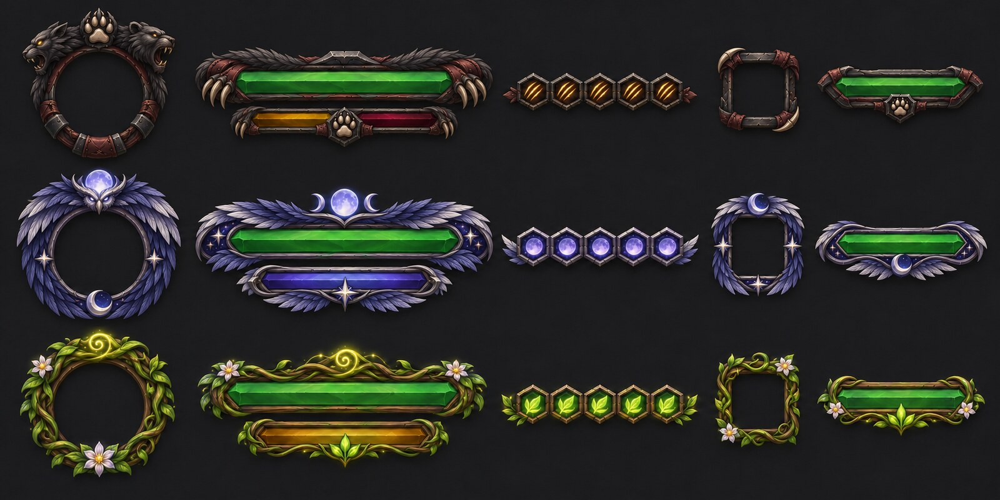

# Согласованная концепция тем друида

Статус: визуальное направление утверждено пользователем 9 ноября 2026 года. Тема Feral добавлена в аддон как выбираемый вариант; Balance и Restoration остаются следующими этапами.

## Три темы

### Feral — кошка и медведь

- Общая палитра: чёрный мех, угольные оттенки, тёмно-красные детали.
- Обе формы должны быть одинаково узнаваемы: кошачий образ и медвежий образ остаются частью одной темы.
- Энергия кошки: жёлтый янтарный цвет.
- Ярость медведя: тёмно-бордовый, кровавый цвет.
- В первой реализации заменены рамки полос, портретов, группы/питомца и кнопок; цвет энергии и ярости меняется по текущему ресурсу друида.
- Автоматического переключения самой темы при смене формы нет: игрок выбирает Feral в настройках скина.

### Balance — сова / лунная форма

- Перья вместо листьев и зелёных лоз.
- Образ совы, лунные и звёздные мотивы.
- Палитра мокапа: холодные сине-фиолетовые оттенки, серебристые перья.

### Restoration

- Сохранить зелёную природную палитру и живые растительные мотивы из первого мокапа.

## Порядок работы

1. Сначала сделать Feral.
2. Затем Balance.
3. После них Restoration.

В текущем MyCustomFrames выбор темы общий и ручной. Автоматического переключения по специализации или форме в аддоне пока нет.
