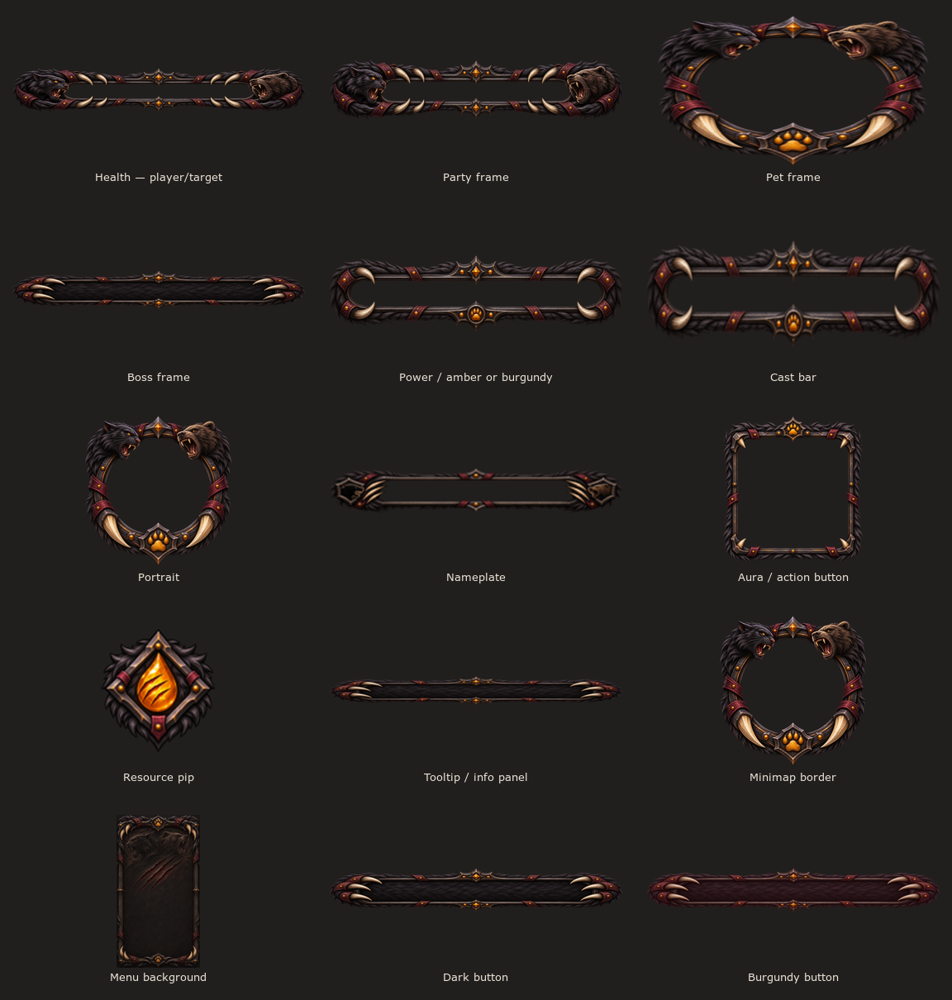

# Согласованная концепция тем друида

Статус: визуальное направление утверждено пользователем 9 ноября 2026 года. Тема Feral добавлена в аддон как выбираемый вариант; Balance и Restoration остаются следующими этапами.

## Feral — интеграция утверждённого макета

Лист выше собран из игровых `.tga` в `Assets/Feral`, а не из отдельного концепт-арта. Все 29 текстурных слотов Feral теперь используют общий стиль чёрного меха, тёмного железа, бордовой кожи и крупных костяных когтей. 14 главных текстур получили новые отдельные иллюстрации; подсветки, рамки питомца и группы, кастбар и служебные панели собраны из соответствующих элементов того же набора и подогнаны под размеры своих игровых слотов.

Рамки здоровья и ресурсов оставляют центр прозрачным, чтобы игровые полосы отрисовывались динамически. Зелёное здоровье, янтарная энергия кошки и бордовая ярость медведя задаются кодом, а не запекаются в рамки.

## Три темы

### Feral — кошка и медведь

- Общая палитра: чёрный мех, угольные оттенки, тёмно-красные детали.
- Обе формы должны быть одинаково узнаваемы: кошачий образ и медвежий образ остаются частью одной темы.
- Энергия кошки: жёлтый янтарный цвет.
- Ярость медведя: тёмно-бордовый, кровавый цвет.
- В Feral входят парная эмблема кошки и медведя с лапой, когтистые рамки юнитов, портрет, неймплейты, фон и кнопки главного меню, подложки и рамки подсказок, мини-карта и декоративный шрифт заголовка.
- Энергия и ярость меняются по текущему ресурсу друида; основной шрифт цифр и мелких подписей остаётся хорошо читаемым.
- Автоматического переключения самой темы при смене формы нет: игрок выбирает Feral в настройках скина.

### Balance — сова / лунная форма

- Перья вместо листьев и зелёных лоз.
- Образ совы, лунные и звёздные мотивы.
- Палитра мокапа: холодные сине-фиолетовые оттенки, серебристые перья.

### Restoration

- Сохранить зелёную природную палитру и живые растительные мотивы из первого мокапа.

## Порядок работы

1. Сначала сделать Feral.
2. Затем Balance.
3. После них Restoration.

В текущем MyCustomFrames выбор темы общий и ручной. Автоматического переключения по специализации или форме в аддоне пока нет.
